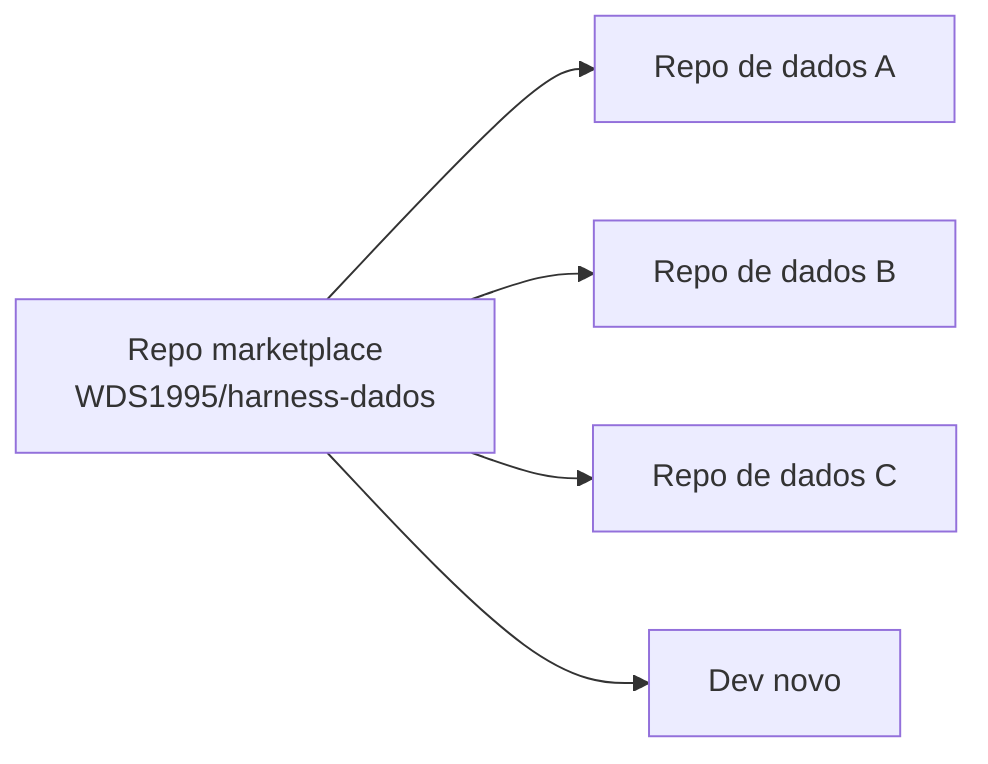
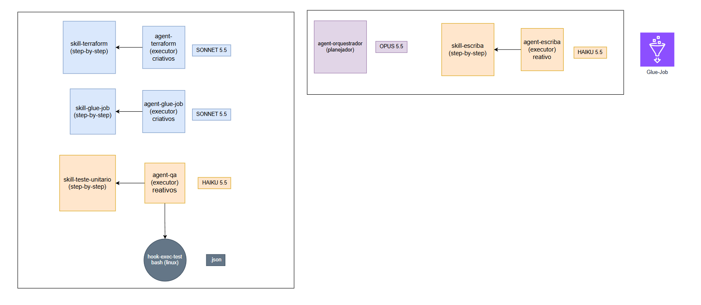
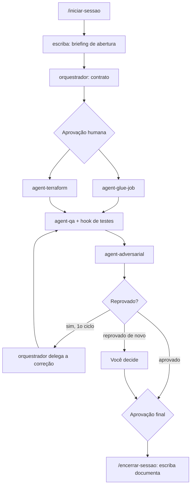
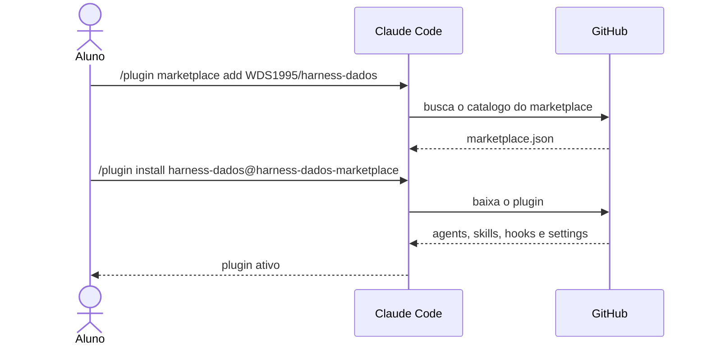

# harness-dados

Plugin do Claude Code para **Engenharia de Dados**. Ele organiza a criação de **AWS Glue Jobs (PySpark) com Terraform** em um fluxo com contrato de entrega, agents especializados, testes unitários obrigatórios, revisão adversarial e documentação automática. Você instala uma vez, de um marketplace, e usa em qualquer repositório de dados.

> **Material de aula.** Este repositório acompanha a trilha de Claude Code da plataforma **Ensina Dados** (Prof. Wellington Domiciano · Wbigdata). Ele é um ponto de partida para estudar e adaptar, não um produto com garantias. Revise tudo antes de usar em produção.

## Sumário

1. [Por que um harness?](#por-que-um-harness)
2. [Por que um Marketplace?](#por-que-um-marketplace)
3. [Arquitetura](#arquitetura)
4. [Pré-requisitos](#pré-requisitos)
5. [Instalação passo a passo](#instalação-passo-a-passo)
6. [Como usar](#como-usar)
7. [Exemplo pronto](#exemplo-pronto)
8. [Estrutura deste repositório](#estrutura-deste-repositório)
9. [Limitações conhecidas](#limitações-conhecidas)
10. [Desafio](#-desafio)
11. [Créditos](#créditos)

---

## Por que um harness?

O modelo é o **motor**. O harness é o **carro**: instruções, agents, skills, hooks, memória e contrato de entrega. Um motor potente sem carro leva você a lugar nenhum, ou a um muro.

Usar o Claude Code "cru" em um time de dados costuma dar estes problemas:

- **Contexto inconsistente:** cada pessoa explica o projeto de um jeito, e o resultado muda a cada sessão.
- **Sem teste:** o código "parece certo", mas ninguém prova.
- **Sem revisão:** quem escreveu é quem aprova.
- **Sem documentação:** a decisão tomada na sessão some quando ela termina.
- **Cada dev configura do seu jeito:** agents, prompts e permissões copiados, alterados e esquecidos.

O harness resolve isso com uma regra simples de projeto: **o que precisa ser cumprido é determinístico; o que é orientação é instrução**.

| Tipo | Mecanismo | Exemplo neste harness |
|---|---|---|
| Regra que **precisa** ser cumprida | Hook, permissions | O hook roda a suíte de testes inteira, com cobertura, toda vez que o agent-qa salva um `.py` |
| Orientação e conhecimento | `CLAUDE.md`, rules, skills | Como escrever um Glue Job, como estruturar o Terraform, como montar o contrato |

Um hook sempre executa. Uma instrução o modelo pode seguir bem... ou não. Por isso o que não pode falhar fica no hook.

## Por que um Marketplace?

Você poderia simplesmente copiar a pasta `.claude/` de um repo para outro. Funciona no começo. Depois de três repos, você tem três versões diferentes do mesmo harness, e ninguém sabe qual é a certa.

Um **plugin versionado em um marketplace** troca a cópia por uma fonte única:

- **Fonte única de verdade:** agents, skills e hooks vivem em um só repositório.
- **Atualização com um comando:** corrigiu uma skill? O time inteiro atualiza com `/plugin marketplace update harness-dados-marketplace`.
- **Padronização entre repos:** todo repo de dados roda o mesmo fluxo, com os mesmos agents e as mesmas regras.
- **Onboarding em minutos:** dev novo instala o plugin, roda `/harness-dados:iniciar-sessao` e já trabalha no padrão do time.
- **Governança:** o que o time usa está em um repo revisado por PR, com histórico. Nada de alteração silenciosa em um `.claude/` esquecido.
- **Separação de responsabilidades:** o **harness** (o plugin) é uma coisa; o **repo de dados** (o consumidor) é outra. O harness evolui sem tocar no código de produção.



### Copiar arquivos × Marketplace

| Aspecto | Copiar `.claude/` entre repos | Plugin via marketplace |
|---|---|---|
| Fonte da verdade | Várias cópias divergentes | Um repositório |
| Atualização | Manual, repo a repo | Um comando |
| Padronização | Depende da disciplina de cada um | Garantida pela instalação |
| Onboarding | Copiar, ajustar, torcer | Dois comandos |
| Revisão e histórico | Perdidos ou espalhados | PR e git no repo do plugin |
| Separação harness x código | Misturados no repo de dados | Plugin separado do repo consumidor |

### O que um plugin pode e não pode distribuir

Plugin distribui **agents, skills, hooks e settings**. Ele **não distribui** `CLAUDE.md` nem `rules`. Duas decisões deste projeto nascem dessas limitações:

- **Decisão 22, bootstrap por `templates/`:** como o plugin não entrega `CLAUDE.md` e rules, a skill `/harness-dados:iniciar-sessao` cria esses arquivos no repo de dados, a partir de `templates/`, na primeira execução (sem sobrescrever nada que já exista).
- **Decisão 20, hook global filtrado por `agent_type`:** agents que vêm de plugin ignoram `hooks` no frontmatter. Então o hook de testes é declarado de forma global e filtra pelo `agent_type` do agent-qa.

## Arquitetura

Toda sessão roda com o **orquestrador** como agent principal (ativado pelo `settings.json` do plugin). Ele não escreve código: planeja, escreve o contrato, delega e consolida. Só ele delega; subagents não chamam outros subagents.



### Fluxo da sessão



Regras do fluxo:

- Nenhum código é escrito sem um contrato **aprovado por você**.
- Glue Job e Terraform são feitos **em paralelo**; QA e revisão adversarial, **em sequência** (o adversarial revisa também os testes).
- Só **1 ciclo de correção**. Se o adversarial reprovar de novo, quem decide é você.
- Os agents **nunca** executam `terraform plan/apply/destroy` nem comandos na AWS. Comandos sem permissão pedem a sua aprovação na hora.
- Testes **apenas unitários**, com PySpark e `awsglue` mockados e cobertura mínima de **95%** de todo o código.

### Componentes

| Componente | Modelo | Papel | Skill |
|---|---|---|---|
| orquestrador | Opus | Sessão principal: planeja, escreve o contrato, delega, consolida | skill-contrato |
| agent-glue-job | Sonnet | Código PySpark do Glue Job (`jobs/`) | skill-glue-job |
| agent-terraform | Sonnet | Infraestrutura (`infra/`) | skill-terraform |
| agent-qa | Haiku | Escreve e corrige testes unitários (`tests/`) | skill-teste-unitario |
| agent-adversarial | Opus | Revisão independente de código, Terraform e testes; somente leitura | n/a |
| agent-escriba | Haiku | Briefing na abertura e documentação no encerramento | skill-escriba |
| hook-exec-test | n/a | Roda a suíte inteira com cobertura a cada `.py` salvo pelo agent-qa e devolve só o resumo | n/a |

### Por que cada modelo

- **Opus planeja e revisa:** decisões de contrato e julgamento crítico pedem o modelo mais forte. O revisor precisa ser, no mínimo, do nível de quem executou.
- **Sonnet cria:** escrever código de Glue Job e Terraform é trabalho criativo e volumoso.
- **Haiku reage:** testes guiados pelo resumo do hook e registro de sessão são tarefas reativas e baratas.

## Pré-requisitos

- **Claude Code atualizado**, com **auto memory ligada** (os agents usam memória de projeto).
- **Python 3.11+** no PATH. No repo de dados: `pip install -r requirements-dev.txt` (o arquivo é criado pelo bootstrap).
- **Terraform** (opcional). Sem ele, a validação do Terraform fica registrada como pendência.
- **Conta AWS** com permissão para Glue, S3 e Athena (necessário para o [desafio](#-desafio)).
- **AWS CLI** configurado (para subir arquivos ao S3 e conferir recursos).

## Instalação passo a passo

1. **Adicione o marketplace.** Dentro do Claude Code:

   ```
   /plugin marketplace add WDS1995/harness-dados
   ```

   Conferir: o Claude Code confirma que o marketplace `harness-dados-marketplace` foi adicionado.

2. **Instale o plugin:**

   ```
   /plugin install harness-dados@harness-dados-marketplace
   ```

   Conferir: a instalação do plugin `harness-dados` é confirmada.

3. **Verifique** abrindo o gerenciador:

   ```
   /plugin
   ```

   Conferir: `harness-dados` aparece como instalado e o marketplace `harness-dados-marketplace` aparece na lista. Se os comandos do plugin não aparecerem, **reinicie a sessão** do Claude Code.

4. **Teste** digitando `/harness-dados:` e conferindo se `iniciar-sessao` e `encerrar-sessao` aparecem.



### Alternativa pelo terminal

```bash
claude plugin marketplace add WDS1995/harness-dados
claude plugin install harness-dados@harness-dados-marketplace
```

### Alternativa para teste local

Sem instalar nada, apontando para uma cópia local do repositório:

```bash
git clone https://github.com/WDS1995/harness-dados.git
claude --plugin-dir <caminho-para-harness-dados>
```

### Atualizar e desinstalar

```
/plugin marketplace update harness-dados-marketplace
```

Para desinstalar, use o gerenciador `/plugin` e remova o plugin `harness-dados`. Pelo terminal:

```bash
claude plugin marketplace update harness-dados-marketplace   # baixa a versão mais nova do repo
claude plugin update harness-dados                           # atualiza o plugin instalado
claude plugin uninstall harness-dados                        # remove o plugin
claude plugin marketplace remove harness-dados-marketplace   # remove o marketplace
```

## Como usar

Em um repo de dados novo:

1. **Crie a pasta e inicialize o git:**

   ```bash
   mkdir meu-repo-de-dados && cd meu-repo-de-dados
   git init
   ```

2. **Abra o Claude Code** na pasta: `claude`.

3. **Inicie a sessão:**

   ```
   /harness-dados:iniciar-sessao
   ```

   Na primeira vez, o bootstrap cria (sem sobrescrever nada existente):

   ```
   CLAUDE.md
   .gitignore               ignora .coverage, __pycache__/, .terraform/, *.tfstate etc.
   .claude/rules/           regras por tipo de arquivo (glue-job, terraform, testes)
   tests/__init__.py
   pyproject.toml
   requirements-dev.txt
   docs/contexto/glossario.md
   .entregas/               backlog.md e sessao.json
   ```

   Depois o escriba faz o briefing de abertura e o orquestrador pergunta: continuar uma entrega ou iniciar um novo pedido.

4. **Descreva o pedido.** Exemplo:

   > Crie um Glue Job que leia o CSV de pedidos em `s3://<seu-bucket>/entrada/pedidos.csv`, remova pedidos sem `id_cliente`, normalize o status para maiúsculas, calcule o valor total com desconto por faixa e grave em Parquet, particionado por mês, com tabela no Glue Catalog.

5. **Responda às perguntas** do orquestrador. Ele esclarece o que faltar antes de escrever o contrato.

6. **Aprove o contrato.** É o primeiro portão humano: nada é codificado antes disso.

7. **Acompanhe os agents.** Glue Job e Terraform em paralelo, depois QA com o hook de testes, depois a revisão adversarial. Aprove ou negue os comandos que pedirem permissão.

8. **Aprovação final.** Com a entrega aprovada pelo adversarial, você dá o segundo ok.

9. **Encerre:**

   ```
   /harness-dados:encerrar-sessao
   ```

   Os agents registram aprendizados, o escriba documenta e você aprova o que vira memória permanente.

### Estrutura gerada no repo de dados

```
CLAUDE.md
.claude/rules/          regras por tipo de arquivo
.claude/agent-memory/   memória de cada agent
jobs/<nome_job>/        job.py (ponto de entrada) + transform.py (regras)
tests/                  testes unitários + conftest.py com os mocks
infra/                  modules/glue_job + jobs/<nome_job>.tf
docs/jobs/              documentação por job
docs/decisoes/          ADRs
.entregas/
CHANGELOG.md
```

### A pasta `.entregas/`

É o controle da sessão, separado da memória dos agents:

| Item | O que é |
|---|---|
| `backlog.md` | Lista das entregas (`ENT-0001`, `ENT-0002`...) |
| `sessao.json` | Início e fim da sessão e a entrega ativa |
| `<ID>-<nome>/contrato.md` | O que será entregue, regras e critérios de aceite, aprovado por você |
| `<ID>-<nome>/plano.md` | Plano de execução e delegações |
| `<ID>-<nome>/estado.json` | Fase atual da entrega (permite retomar depois) |
| `<ID>-<nome>/progresso.md` | Diário do que cada agent fez |
| `<ID>-<nome>/qa/` | Relatórios de teste e cobertura |

## Exemplo pronto

Em [`examples/glue-job-sample/`](examples/glue-job-sample/) está uma **entrega real feita em aula** com este harness: um Glue Job que lê um **CSV de alunos**, aplica regras em **Spark SQL**, grava **Parquet** e cataloga no **Glue Catalog**.

- **32 testes** unitários, **cobertura de 100%**
- **Revisão adversarial aprovada**
- **Executado na AWS** e consultado no **Athena**

Navegue pelo `CLAUDE.md`, `docs/`, `jobs/` e `tests/` do exemplo para ver o que o harness produz. Como é o gabarito do [desafio](#-desafio), **tente fazer o seu antes de olhar**.

## Estrutura deste repositório

```
.claude-plugin/   plugin.json e marketplace.json
settings.json     define o orquestrador como agent principal
agents/           orquestrador e subagents
skills/           skills de domínio e de sessão
hooks/            hooks.json + exec_test.py
templates/        arquivos criados no repo de dados pelo /iniciar-sessao
examples/         glue-job-sample: entrega de referência feita em aula
docs/img/         diagrama de arquitetura
BACKLOG.md        correções e melhorias abertas
CLAUDE.md         arquitetura e decisões do harness
```

## Limitações conhecidas

- O foco é **AWS Glue + Terraform**. Outras ferramentas (dbt, Airflow etc.) não fazem parte do harness.
- IAM de menor privilégio e qualidade de dados estão fora do escopo inicial.
- Sem versionamento formal do plugin por enquanto.
- Itens abertos estão no [BACKLOG.md](BACKLOG.md), por exemplo **H-02** (o import do `transform.py` difere entre Glue e testes) e **H-12** (desvio de script único quando Libraries está desligado).

## 🎯 Desafio

**Crie um Glue Job usando o harness e execute-o na AWS.**

1. Instale o marketplace e o plugin (seção [Instalação](#instalação-passo-a-passo)).
2. Crie um repo de dados novo (`git init`) e abra o `claude`.
3. Rode `/harness-dados:iniciar-sessao`.
4. Peça um job com **dataset fictício diferente do exemplo** (sugestão: **vendas** ou **pedidos**; ou escolha livremente), com regras de transformação claras: filtros, normalização, coluna calculada, particionamento.
5. Responda às perguntas e **aprove o contrato**.
6. Acompanhe até os testes chegarem a **cobertura >= 95%** e o **adversarial aprovar**.
7. Suba o **script** e o **CSV** para um bucket S3 seu.
8. Crie e rode o job: pelo console da AWS, ou pelo **Terraform gerado pelo agent-terraform**. Revise o `terraform plan` você mesmo; os agents nunca rodam `apply`.
9. **Consulte o resultado no Athena.**
10. Encerre com `/harness-dados:encerrar-sessao`.

### Concluído quando

- [ ] Marketplace e plugin instalados e visíveis em `/plugin`
- [ ] Contrato aprovado por você, em `.entregas/`
- [ ] Testes unitários passando com cobertura >= 95%
- [ ] Revisão adversarial com resultado APROVADO
- [ ] Script e CSV no S3
- [ ] Glue Job executado com sucesso na AWS
- [ ] Tabela consultada no Athena, com o resultado esperado
- [ ] Sessão encerrada com `/harness-dados:encerrar-sessao`

> **Custo:** Glue, S3 e Athena geram cobrança. Ao terminar, apague o job, os dados e as tabelas de teste, e rode `terraform destroy` você mesmo se usou Terraform.
>
> **Segurança:** nunca commite credenciais, chaves de acesso ou nomes reais de conta e bucket. Use perfis do AWS CLI e variáveis.

## Créditos

Prof. Wellington Domiciano · Ensina Dados
